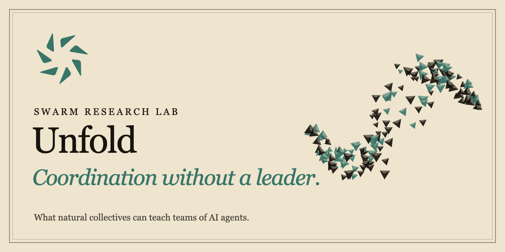

  

**Unfold is a swarm research lab.** We study what collective mechanisms from nature (ant trails, lateral inhibition,
quorum, recruitment) can do for teams of AI agents, and we test them against the coordination people ship: a manager
agent or a group chat. Biology proposes; preregistered experiments decide. We publish what fails.

### Open research

| | |
|---|---|
| 🧪 **[bioswarm](https://github.com/unfold-research/bioswarm)** | The BioSwarm engine and the lab's open record: findings, 224 hypotheses, 127 preregistrations, study reports and independent reviews, plus the protocol and SDK. |
| 🧩 **[bioswarm-plugin](https://github.com/unfold-research/bioswarm-plugin)** | The open plugin: shared field, tie-break and message and spending ceilings, enforced in code inside the agent loop (Pi, OpenBot on Pi). |

### Where to start

- [What we believe now](https://github.com/unfold-research/bioswarm/blob/main/research/FINDINGS.md), with what would
  change each belief.
- The [lab notebook](https://unfold.host/research/), the readable version.
- [Colony](https://unfold.host/colony/), the product built on BioSwarm (in internal testing, releasing soon).

No proven advantage of any swarm over a single agent or a manager agent is claimed. That is the question.

Made in Brazil · [unfold.host](https://unfold.host) · Code Apache-2.0 · Research CC BY 4.0
